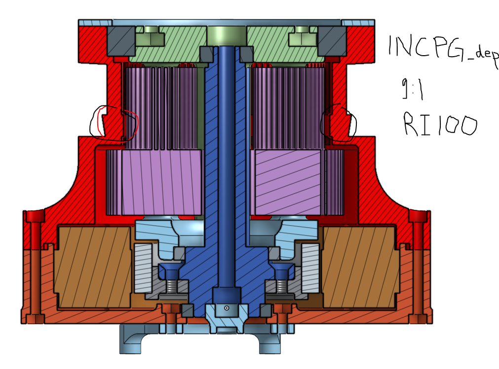
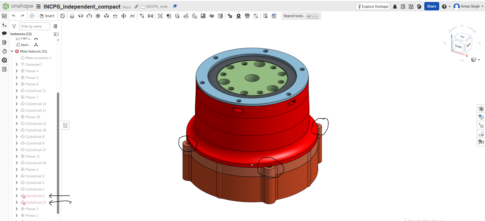
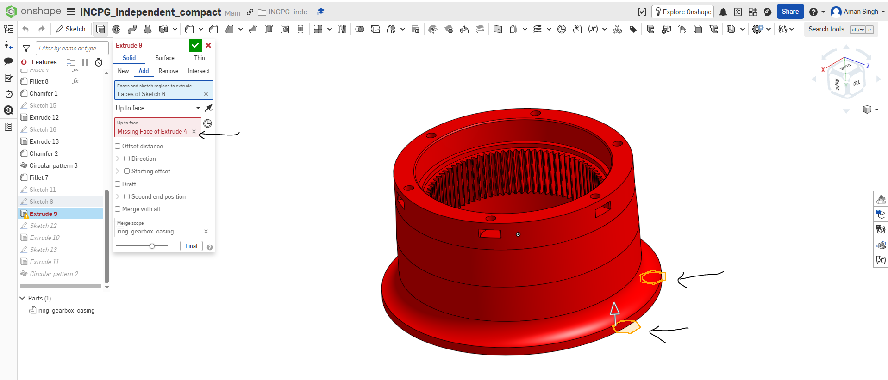

# Features / TODO & Bugs

## Features / TODO

### Testing

**Status: done.** Details and commands are in [tests/README.md](tests/README.md).
- **Fast tests** (`pytest`, about 5 s): every gearbox type builds, the config and motor files are
  valid, the Onshape push works against a fake Onshape, the README/docs commands and links are
  correct, and the actuator-map sweep equals the plain optimiser. CI runs them on every push (`.github/workflows/checks.yml`).
- **Golden-output check** (`tests/golden/golden.py`, 58 cases, about 30 s): every gearbox type
  with its golden motors, plus one metal case per type. It compares the chosen design, the CAD
  equations files and the results CSVs with recorded baselines. Run it before merging any change;
  a change that is meant to alter results re-records only the affected cases.

### Faster search for the two-stage gearboxes (DSPG, IDSPG, INDSPG)

**Status: done (2026-10-29).** The search nested every stage-2 design inside every stage-1 design
and checked each pair: about 228 million pairs for DSPG with a U8, of which only ~15 000 have the
requested ratio. Every check looks at one stage only, so `two_stage_search.py` now lists each
stage's designs once and evaluates only the pairs whose ratio is in the bin, in the original order
(same design chosen, ties included). Times for one ratio: DSPG U8 about 6 min → 3 s, IDSPG RO100
about 2 min → 6 s, INDSPG 5 s → under 1 s; the golden check 10.5 min → 30 s. Checked against the
old code on 59 cases (5 DSPG motors, 3 IDSPG, 2 INDSPG, several ratios incl. bin edges, metal,
multi-ratio sweeps): all identical. `tests/test_two_stage_search.py` compares the fast search with
the original nested loops on a small search. The unused PSC search versions are unchanged.

### Phase 3b — move the gearbox modules into a folder

**Status: open.** Goal: only the entry points (`actOpt.py`, `gearbox_runner.py`,
`CommonComponents.py`) stay in the root; the 11 `ActuatorAndGearbox*.py` / `ActuatorandGearbox*.py`
modules move to `gearboxes/`. (The old plan for this also moved the `Opt_*.py` driver scripts and
`run_all.sh`; Phase 3a replaced those with `gearbox_runner.py`, so only the modules are left.)

**Open decision (first):** split `ActuatorAndGearbox.py` (SSPG, CPG, WPG and DSPG in one file,
about 11 300 lines) into one file per type before the move, so `gearboxes/` holds one module per
type.

**Steps:**
1. Decide the folder name and the split above.
2. `git mv` the modules into `gearboxes/` (with an `__init__.py`).
3. Point `GearboxSpec.module` in `gearbox_runner.py` at `gearboxes.<module>`; fix the modules'
   `from CommonComponents import ...` lines so they still find `CommonComponents.py` in the root.
4. Update the tests that look for the modules in the root (e.g. the `cad_path` guard in
   `tests/test_common_components.py`) and the module paths in `docs/gearboxes.md` and the README.
5. Check: `pytest` and the full golden check — nothing may change.

### README rewrite

**Status: done** (Phase 4, PR #85, 2026-10-23). The README is a short guide for new users (install,
quick start, the 15 gearbox types with Onshape links, motors, material modes, CAD, developers),
with details in [docs/gearboxes.md](docs/gearboxes.md), [docs/motors.md](docs/motors.md) and
[docs/onshape.md](docs/onshape.md). `tests/test_docs.py` checks that every command uses a real
gearbox type and motor, every type is listed, and every link to a repo file exists. Later
changes: INSSPG labels and the view-only notes (PR #91), "What's new" (PR #89).

### Motor-parameter pipeline — one motor file for every gearbox type

**Status: done** (Phase 2, PR #80, 2026-10-17). All 33 motors are in
[`config_files/motors.json`](config_files/motors.json), with datasheet sources; every gearbox type
reads them with `CommonComponents.load_motor()`. Gears are sized with peak torque, checked at
no-load speed (48 V); `"rating": "rated"` switches frameless motors to rated values. How to add a
motor: [docs/motors.md](docs/motors.md); checks: `tests/test_motors.py`.

### Material modes — 3D-printed and metal

**Status: done** (PR #84, 2026-10-22). `python actOpt.py ... --material 3dp|metal` (default
`3dp`): 3dp = PLA gears and structure; metal = steel gears (7850 kg/m³, 400 MPa) and aluminium
structure (2700 kg/m³), from the one material table in `config_files/config.json`. Mass functions
weigh gears and structure with their own densities; the separate rotor couplers (INCPG, INWPG,
INDSPG) are aluminium in both modes. Metal results go to `..._metal.csv`. The golden check has one
metal case per gearbox type.

**Follow-up tasks (not part of the first version):**
1. **Split the ring gear into teeth and housing.** In the gearboxes where the ring gear is part of
   the outer housing, its mass currently includes the housing around it. In metal mode the teeth
   should be steel and the housing aluminium, so each mass function must compute the two volumes
   separately. Until then, the whole ring part is weighed as steel in metal mode, which
   overestimates the mass.
2. **Separate thicknesses and clearances for metal mode.** Metal parts don't need the 3D-printing
   clearances (e.g. `loose_clearance_3DP`) and can be thinner than printed ones. Metal mode needs
   its own design settings per gearbox; until then it reuses the 3D-printed shapes.

### Unify per-gearbox settings (important — most items change results)

Found while building the common runner (Phase 3a). The runner keeps every one of these
differences exactly as it was, so results don't change; each should later become its own
result-changing commit with re-recorded golden baselines.

1. ~~**Five config files with different material values.**~~ Each gearbox type reads materials, cost
   gains and MIT factors from one of five files:

   | Config file | Used by | PLA density | Aluminium density | Steel |
   |---|---|---|---|---|
   | `config.json` | SSPG, CPG, WPG, DSPG, ISSPG ×2, INCPG ×2, INWPG ×2 | 1250 | 2700 | 7850 / 400 MPa |
   | `motor_config.json` | ICPG | 1245.6 | **1245.6** (PLA value) | **1245.6 / 70** (PLA values) |
   | `idspg_motor_config.json` | IDSPG | 1245.6 | **1245.6** | **1245.6 / 70** |
   | `indspg_motor_config.json` | INDSPG | 1240 | 2700 | 7850 / 400 MPa |
   | `insspg_motor_config.json` | INSSPG ×2 | 1240.06 | 2700 | 7850 / 400 MPa |

   So PLA has four densities (1250, 1245.6, 1240, 1240.06), and two files give aluminium and steel
   PLA values. Cost gains (1 / −2 / 0.2) and MIT factors (1.2 / 1.5) are the same in all five.
   **Done (2026-10-22, PR #84):** every type now reads materials from the one table in
   `config.json`; the other four files no longer have `Material_properties`.
2. ~~**ISSPG hard-codes FOS 1.2 and service factor 1.5**~~ — **done (2026-10-28):** ISSPG (inside
   and compact) now reads `MIT_params` from `config.json` like the other types (same values, so
   results unchanged).
3. **Motor driver passed inconsistently:** OdrivePro for most types; `None` for INSSPG; not passed
   at all for ICPG and INDSPG.
4. **Different maximum-gearbox-diameter rules:**
   - SSPG, WPG, DSPG: small-motor factor × motor Ø − 2 × ring width (different ring-width keys:
     `ringRadialWidthMM`, `ringRadialWidthMMBig`, `ring_radial_thickness`);
   - CPG: small-motor factor × motor Ø;
   - ICPG: factor × stator ID; IDSPG: factor × (motor OD + 2 × 1.5) and stage 1 = stator ID − 2 ×
     ring-1 width; INDSPG: factor × (stator wire OD − 2 × ring-2 width) and stage 1 = rotor ID −
     4 × 1.5;
   - INCPG, INWPG: factor × motor Ø; INSSPG: stator OD − 5.5 − 2 × 1.5 − 0.8 / 2;
   - ISSPG: no limit passed.
   The IDSPG line carries a `#TODO: this is correct and implement in other also`.

5. ~~**Cost gains copied into five config files**~~ (and `K_torque_shortfall` into four params
   files), all with the same values, so a gain changed in one file would have given that type a
   different cost. **Done (2026-10-29):** every type reads one set from `config_files/cost.json`
   (`K_Mass`, `K_Eff`, `K_Width`, `K_torque_shortfall`; plus `K_Width_real` for the actuator map);
   `tests/test_cost_gains.py` keeps it that way. Same values, so results unchanged (golden 58/58).

**Status:** items 1, 2 and 5 done; items 3 and 4 open — decide one value / rule per item, then
change and re-record one item at a time.

### Optimise with the real actuator width (future)

The optimiser's cost uses `K_Width` × the planet face widths, not the actuator's length. Within one
type that ranks designs almost the same (the real width is the planet widths plus fixed sizes and
bearing heights), but between types it compares different things: one planet width for
single-stage, two steps for compound/Wolfrom, both stages for double-stage; casings, bearings and
the motor are not counted. The actuator map (`tools/actuator_map/`) therefore adds a second score
with the real width (`K_Width_real` in `cost.json`) after the sweep.

**To do it in the optimiser:** move the width formulas of `tools/actuator_map/geometry.py` (matched
to Onshape) into each gearbox type's cost; make the CAD variables they need available during the
search; re-tune `K_Width` (per mm of whole actuator, not of gear); re-record every golden baseline
(every result changes). Overlaps with bug 15 (`actuator_width` vs the CAD). About 1–2 sessions.

**Status:** future — decided 2026-10-29 to use the map's second score for now.

## Bugs

### 1. `bearings_discrete` — OD table vs ID table content differ

**Description:** `bearings_discrete` (in `CommonComponents.py`) supports two lookup
modes — by inner diameter (`idRequiredMM`, the default) and by outer diameter
(`odRequiredMM`, opt-in) — but the two modes draw from **two different bearing
catalogues**, not one shared table. 28 rows are common to both, but:
- Rows only in the OD-table (never reachable via an ID-based lookup):
  `[44.45, 53.975, 6.35, 0.031]`, `[50, 62, 6, 0.036]`
- Rows only in the ID-table (never reachable via an OD-based lookup):
  `[28, 52, 12, 0.096]`, `[32, 58, 13, 0.122]`

Practical effect: the same nominal bearing requirement can resolve to a **different
physical bearing** depending on whether the caller looks it up by ID or by OD.

**Reproduce:**
```python
from CommonComponents import bearings_discrete

b_od = bearings_discrete(idRequiredMM=0, odRequiredMM=62)
print(b_od.getBearingIDMM(), b_od.getBearingODMM(), b_od.getBearingWidthMM(), b_od.getBearingMassKG())
# 50 62 6 0.036

b_id = bearings_discrete(idRequiredMM=50)
print(b_id.getBearingIDMM(), b_id.getBearingODMM(), b_id.getBearingWidthMM(), b_id.getBearingMassKG())
# 50 65 7 0.05
```
Both calls describe a "50mm ID bearing," but the OD-lookup returns a 50×62×6mm bearing
while the ID-lookup returns a 50×65×7mm bearing — verified live, output as shown above.

**Probable fix:** merge the two catalogues into one combined table so both lookup modes
draw from the same rows. This is a bigger, more consequential change than a typical bug
fix — it would alter which physical bearing gets selected for some existing inputs — so
it should be a deliberate decision rather than folded in silently.

**Status:** open — not yet fixed.

### 2. Variants of a family silently overwrite each other's equations file (ISSPG, INCPG, INWPG, INSSPG)

**Description:** `ActuatorAndGearbox_ISSPG_inside.py` and `ActuatorAndGearbox_ISSPG_compact.py`
both call `genEquationFile_editCADdirectly()` automatically whenever `optimizeActuator()` finds a
feasible solution, and both write to the exact same path:
`CADs/ISSPG/isspg_equations_onshape.txt`. Running one gearbox type after the other silently
clobbers the first run's output — no error, no warning, and no filename distinction between
`isspg_inside` and `isspg_compact` results.

**Reproduce:**
```bash
python actOpt.py RO100 isspg_inside 6.5
# CADs/ISSPG/isspg_equations_onshape.txt now holds the isspg_inside solution

python actOpt.py RO100 isspg_compact 6.5
# CADs/ISSPG/isspg_equations_onshape.txt has been silently overwritten with the
# isspg_compact solution instead — confirmed via file size/mtime change (4254 -> 4190 bytes)
```

**Probable fix:** give each variant its own output filename, e.g.
`CADs/ISSPG/isspg_inside_equations_onshape.txt` and
`CADs/ISSPG/isspg_compact_equations_onshape.txt` — a one-line change to the `file_path`
construction in each file's `genEquationFile_editCADdirectly()` (currently at
`ActuatorAndGearbox_ISSPG_inside.py:826` and `ActuatorAndGearbox_ISSPG_compact.py:821`).

Not only ISSPG: INCPG, INWPG and INSSPG had the same problem (both variants wrote
`CADs/<FAMILY>/<family>_equations*.txt`), so `--onshape` could push one variant's design into the
other variant's model.

**Status:** resolved (2026-10-28) — every gearbox type writes
`CADs/<FAMILY>/<gb_type>_equations*.txt` (e.g. `CADs/INCPG/incpg_dependent_equations_onshape.txt`),
including the per-ratio `Equation_Files/` copies, and `set_values` pushes that file. Non-variant
types keep their names. File contents and results unchanged (golden baselines re-recorded for the
new names only); tests check that variants never share a file and each pushes its own.

### 3. IDSPG has no CAD model or Onshape link

**Description:** `idspg` is a supported gearbox type (`actOpt.py` → `Opt_IDSPG.py`, motor
`RO100`) and the optimiser writes `CADs/IDSPG/idspg_equations.txt` and
`CADs/IDSPG/idspg_equations_onshape.txt`, but there is no CAD model to load them into:
- `README.md` has no "Open IDSPG in Onshape" link (every other type with an `_onshape`
  equations file has one), and does not mention IDSPG at all.
- `CADs/IDSPG/` holds only the generated equation files — no SolidWorks assembly and no
  link.
- It was never committed: the `dev-IDSPG` branch (commits `651ec36`, `e555672`, `0da3c4a`)
  added only the optimiser, configs and equation file.

Practical effect: IDSPG results cannot be visualised or checked in CAD, so mass and
geometry changes to IDSPG can't be verified.

**Probable fix:** the IDSPG designer shares the Onshape document; add it to the README's
Onshape link list in the same format as INDSPG. (Unconfirmed lead:
`Onshape_extension/read_values.py:7` points to an Onshape document, `694cff33…`, that is
not in the README.)

**Blocks:** the IDSPG double-counted bearing mass fix (bug 7) and the other result-changing
fixes, which are on hold until their CAD models can be checked.

**Status:** resolved — Mahiraj Seervi added the Onshape link to the README (`513373b`,
2026-10-15). The IDSPG bearing-mass fix is unblocked.

### 4. INSSPG type 2 — old ring-gear mass formula overwrites the new one

**Description:** in `ActuatorandGearbox_INSSPG.py`, `_getMassKG_3DP_type2()` computes the ring-gear
mass twice, and the second, older calculation always wins:
1. **New calculation (lines 1141–1172):** compares the bearing with the ring gear
   (`bearing_OD - 2×clearance` vs `Nr × module + loose clearance`) and picks one of two ring
   shapes. Each counts 5 volumes — top mount, bearing step, ring gear, bottom part, and the
   support below the bearing — and includes the 3D-printing clearances. Sets `ring_mass` at
   line 1159 or 1172.
2. **Old calculation (lines 1176–1182):** one simple shape with 4 volumes (no support below the
   bearing, most clearances left out). Runs unconditionally right after, and sets `ring_mass`
   again at line 1182.

Practical effect: the new ring-mass model is computed and then discarded. INSSPG type 2's ring
mass, total mass and optimisation result all use the old simple formula.

**History** (all mahi07-06):
- `91a178d` (2026-07-01 12:03): first INSSPG version, type 1 only, with one simple ring formula
  — the "old" block.
- `bc84c74` (2026-07-01 21:52): type 2 added as a copy of type 1. The new conditional ring
  calculation was added to **both** types; in type 1 the old formula was commented out
  (lines 1407–1413), in type 2 it was left active.
- Nothing in either ring section has changed since; `3a1a6b8` (2026-07-02, "changed mass
  function of ring gear for type 2") changed the middle casing and the sun-gear limit, not
  the ring block.

So the active old block in type 2 is very likely an oversight from copying type 1.

**Reproduce:** read `_getMassKG_3DP_type2()` — `ring_mass` is assigned inside the
`if left_side > right_side:` / `else:` branches (lines 1159, 1172) and then unconditionally
at line 1182, with nothing using the first value in between. Compare `_getMassKG_3DP_type1()`,
where the same old block (lines 1407–1413) is commented out.

**Probable fix:** delete the old block (lines 1175–1182) so type 2 uses the new calculation,
as type 1 does. Only `insspg_type_2` results change (ring mass and total mass; possibly the
chosen design); re-record its golden baselines in the same commit and list the before/after
numbers. Check the result against the INSSPG type 2 Onshape model.

**Status:** open — planned as Phase 1 fix 2.3; heads-up to mahi07-06 before applying.

### 5. Bearing lookup by OD picks a bearing larger than the space for it

**Description:** three places size a bearing from the space available for its outer diameter,
so the value is a **maximum** OD. They look it up with
`bearings_discrete(idRequiredMM=0, odRequiredMM=...)`, which returns the **first bearing whose
OD is at least** that value — a bearing slightly larger than the space:

| File | Lines | Bearing | Space (max OD) |
|---|---|---|---|
| `ActuatorandGearbox_INSSPG.py` | 466–467 | rotor support | `Rotor_ID - 4` |
| `ActuatorandGearbox_INSSPG.py` | 481–482 | rotor upper support | `Stator_ID - 1.5 * 5` |
| `ActuatorAndGearbox_ISSPG_compact.py` | 738–739 | sun-2 | `motor_rotor_base_ID` |

Each place has a `#TODO` comment pointing here (INSSPG lines 465 and 480, ISSPG compact
line 737). In INSSPG the variables are named `IdrequiredMM_R_S` / `IdrequiredMM_R_U_S` even
though they hold an OD limit.

What is selected today:

| Gearbox / motor | Bearing | Max OD | Selected | Over by |
|---|---|---|---|---|
| INSSPG RI100 | rotor support | 41 mm | 30×42×7 | 1 mm |
| INSSPG RI100 | rotor upper support | 49.5 mm | 40×50×6 | 0.5 mm |
| INSSPG RI80 | rotor support | 36.5 mm | 25×37×7 | 0.5 mm |
| INSSPG RI80 | rotor upper support | 43.5 mm | 35×47×7 | 3.5 mm |
| ISSPG compact RO100 | sun-2 | 60 mm | 50×62×6 | 2 mm |
| ISSPG compact RO80 | sun-2 | 51 mm | 40×52×7 | 1 mm |

Practical effect: the chosen bearings eat into (or exceed) the clearance the code meant to
leave, and the CAD geometry and bearing masses are based on them.

**Reproduce:**
```python
from CommonComponents import bearings_discrete
b = bearings_discrete(idRequiredMM=0, odRequiredMM=41)   # INSSPG RI100 rotor support: Rotor_ID 45 - 4
print(b.getBearingIDMM(), b.getBearingODMM(), b.getBearingWidthMM())
# 30 42 7  -> OD 42 > 41
```

**Probable fix:** add a lookup that returns the **largest bearing whose OD fits** (OD ≤ the
limit) and use it at these three places; rename the INSSPG variables to `OdLimitMM_R_S` /
`OdLimitMM_R_U_S`. This changes the chosen bearings, and so the CAD geometry and mass, for
INSSPG (both types) and ISSPG compact — first confirm in the Onshape models whether the
selected bearings really don't fit, or whether the `- 4` / `- 1.5 * 5` clearances were meant to
allow for this. Related to bug 1 (the ID and OD lookups use different tables).

**Status:** open — needs the INSSPG and ISSPG designers to check in Onshape.

### 6. INSSPG type 2 — which rotor support bearings it uses is unknown

**Description:** `_getMassKG_3DP_type2()` in `ActuatorandGearbox_INSSPG.py` weighs the two rotor
support bearings with typed-in masses (line 1087, `#TODO` at line 1086):
```python
sun_shaft_bearing_mass = 4 * 0.001 + 0.0066 + 0.0079 # mass of both rotor support bearing added
```
6.6 g and 7.9 g fit much smaller bearings than the ones `setVariables()` selects (lines
465–488), which are labelled "for type 1" and weigh 47–48 g together. The code doesn't say which
bearings type 2 uses:
- the bearing selection in `setVariables()` is labelled type 1 only;
- type 2's casing code that would refer to them is commented out (e.g. line 1094,
  `#upper_casing_cy_1_ID = self.rotor_upper_support_bearing_ID`);
- `config_files/insspg_params.json` (lines 93–98) has fixed RI100 sizes (30×42×7 and 40×50×6),
  but the code reading them is commented out (`ActuatorandGearbox_INSSPG.py` lines 457–462).

Type 1 now uses the masses of its selected bearings (line 1319); type 2 still uses the typed-in
values for both RI100 and RI80.

**Probable fix:** the INSSPG designer confirms which bearings type 2 uses (per motor); then
select them in `setVariables()` (or read them from the config) and weigh them with
`CommonComponents.bearing_mass_kg(id, od, width)`, as INCPG does. Re-record the
`insspg_type_2` baselines.

**Status:** open — question for mahi07-06.

### 7. IDSPG — sun-shaft and planet bearings counted twice in each stage

**Description:** in `ActuatorandGearbox_IDSPG.py`, each stage's mass function adds the sun-shaft
bearing and the planet bearings into the stage's bearing total, and then adds them again on
their own when summing the stage:

| | Stage 1 — `getMassKG_3DP_stg1()` (line 1654) | Stage 2 — `getMassKG_3DP_stg2()` (line 1928) |
|---|---|---|
| Sun-shaft bearing, 4 g | line 1873 | line 2088 |
| Planet bearings, 1 g × 2 per planet | lines 1878–1880 | lines 2093–2095 |
| Both included in `bearing_mass` | line 1885 | line 2101 |
| Stage total adds them **again** | lines 1921–1922 | lines 2132–2133 |
| …plus `bearing_mass` (which already holds them) | line 1923 | line 2134 |

```python
# stage 1
bearing_mass = BearingMassKG + sun_shaft_bearing_mass + planet_bearing_combined_mass + 2*0.006   # line 1885
...
Actuator_mass = (self.motorMassKG + ...
                + self.planet_bearing_combined_mass_stg1    # line 1921 <- counted a 2nd time
                + self.sun_shaft_bearing_mass_stg1          # line 1922 <- counted a 2nd time
                + self.bearing_mass_stg1                    # line 1923 <- already contains both
                + ...)
```
`getMassKG_3DP()` (line 2139) adds the two stages.
Each stage total has a `#TODO` comment pointing here (lines 1913 and 2127).

Practical effect: each stage is 4 g + 2 g per planet too heavy. For the golden case
`idspg` RO100 at gear ratio 20 (4 planets in each stage) that is 12 g per stage, **24 g** in
total (reported mass 1.560 kg). Because the error grows with the number of planets, it also
penalises extra planets, so the optimiser may prefer fewer planets than the real mass justifies.

**Reproduce:** read the two stage functions — the values at lines 1873/1880 and 2088/2095 are
summed into `bearing_mass` (lines 1885, 2101) and then added again at lines 1921–1922 and
2132–2131.

**Probable fix:** delete the duplicate lines 1921–1922 and 2132–2133, so `bearing_mass_stg1` /
`bearing_mass_stg2` remain "all bearings in this stage" and each bearing is counted once.
Only `idspg` results change (about −24 g for RO100 at ratio 20; possibly more planets chosen);
re-record its golden baselines with before/after numbers and check against the IDSPG Onshape
model.

Related, not part of this fix:
- line 1885 also adds an unexplained `2*0.006` (12 g) to stage 1 only, with no comment and no
  stage-2 equivalent — question for the IDSPG author;
- the sun-shaft (4 g) and planet (1 g) bearing masses are fixed numbers that don't follow the
  bearing actually chosen.

**Status:** open — planned as Phase 1 fix 2.2; unblocked now that the IDSPG Onshape link is in
the README (bug 3).

### 8. RO100 rotor screw size — M4 or M5 differs between gearbox types

**Description:** the RO100 rotor has 6 holes on PCD 74 that bolt the gearbox input (ISSPG sun hub,
ICPG / IDSPG coupler) to the rotor. The real rotor takes **both M4 and M5** screws, so either is
valid, but the code is not uniform:
- **M4 (`4`):** `CommonComponents.py` line 416 (`motor` class default), `config_files/motor_config.json`
  line 45 and `config_files/idspg_motor_config.json` line 45 — used by ICPG (`Opt_ICPG.py` line 176)
  and IDSPG. The same entry's countersunk head (`rotorCSKHeadUpperDiaMM` 8, `rotorCSKHeadHeightMM`
  2.3) is the M4 size.
- **M5 (`5`):** `Opt_ISSPG_inside.py` line 69 and `Opt_ISSPG_compact.py` line 70 — ISSPG's own copy
  of RO100. ISSPG uses it directly as the sun-hub bolt size
  (`ActuatorAndGearbox_ISSPG_compact.py` line 754, `ActuatorAndGearbox_ISSPG_inside.py` line 743).

So ISSPG designs the sun hub for M5 bolts while the other types use M4, which changes hole/head
sizes and the material around them in the CAD.

Related — ISSPG's RO100 copy also differs elsewhere (`Opt_ISSPG_inside.py` lines 59–75,
`Opt_ISSPG_compact.py` lines 60–76):
- `rotor_height` 33.2 vs 33.45 and `stator_top_rotor_top_offset` 3 vs 2.75 — the user confirmed
  33.45 and 2.75 are correct (2026-10-17); ISSPG's values are wrong;
- `motorMass` 0.525 kg vs 0.71 kg, and RO80 0.265 kg vs 0.352 kg — the user confirmed the datasheet
  masses 710 g and 352 g are correct (2026-10-17); ISSPG's values are wrong.

**Question for the designers:** which screw size should be the standard for the RO100 rotor —
M4 or M5? If M5, the countersunk head size (8 / 2.3) must change with it.

**Probable fix:** once decided, set `motor_rotor_hole_dia` (and, for M5, the countersunk head
size) for RO100 in `config_files/motors.json`; every gearbox reads that one entry. Re-record the
ICPG, ISSPG and IDSPG golden baselines and check the CAD.

**Status:** open — question for the designers. Phase 2 (2026-10-17) removed ISSPG's own motor
copies: all gearboxes now read RO100 from `config_files/motors.json`, which uses **M4** for now (so
ISSPG changed from M5 to M4), with rotor height 33.45, offset 2.75 and the datasheet masses. The
line numbers above refer to the code before that change.

### 9. INSSPG — which of type 1 / type 2 is "dependent" and which "independent"?

**Description:** the old README called `insspg_type_1` "Independent" and `insspg_type_2`
"Dependent", but commit `bc84c74` suggests type 2 is the independent one, and the code itself only
says "TYPE 1 MATH" / "TYPE 2 MATH" (`ActuatorandGearbox_INSSPG.py`, `getMassKG_3DP` router). There
are two Onshape models, "INSSPG_Dependent" and "INSSPG_Independent", so the mapping also decides
which model each type's results belong in.

**Status:** resolved — Mahiraj Seervi confirmed (2026-10-26, `184d9ea`): `insspg_type_1` is
**independent** (Onshape `documents/e0cb8ed6bb2b36cfcadffcf4/...`), `insspg_type_2` is
**dependent** (`documents/97af418b118f30715235cd6a/...`). Labels added to the README,
`docs/gearboxes.md` and `docs/onshape.md`.

### 10. INSSPG type 1 — sun bottom-part volume is almost zero (typo in an exponent)

**Description:** `_getMassKG_3DP_type1()` in `ActuatorandGearbox_INSSPG.py` (line 1299):
```python
sun_bottom_part_volume = np.pi*(self.Rotor_height+self.stator_bottom_step_height_)*((14/2)** - (self.sun_central_bolt_socket_head_dia/2)**2)*1e-9 + ...
```
`(14/2)** - (x)**2` parses as `7 ** (-(x**2))`, i.e. 7 to a large negative power ≈ 0, instead of
`(14/2)**2 - (x)**2`. The first term (a Ø14 mm ring around the central bolt head) therefore adds
almost nothing to the sun's mass. Type 2's version of the same volume (line ~1063) is written
correctly with `**2`.

Practical effect: for RI100 roughly 2 g of PLA missing from the sun (π × (15 + 4.5) mm ×
(7² − 4.25²) mm² ≈ 1.9 cm³), in every INSSPG type 1 design.

**Probable fix:** `((14/2)**2 - (self.sun_central_bolt_socket_head_dia/2)**2)`; check the Ø14 against
the INSSPG CAD (it is a typed-in value, unlike type 2 which uses the bearing ID); re-record the
`insspg_type_1` golden baselines.

**Status:** open — found 2026-10-22 during the rotor-coupler survey.

### 11. INDSPG — rotor coupler inner diameter subtracts the wall thickness only once

**Description:** in `ActuatorandGearbox_INDSPG.py` (line 1748), the aluminium rotor coupler is
modelled as a tube with a bottom disc:
```python
rotor_coupler_OD = self.rotor_ID
rotor_coupler_ID = self.rotor_ID - rotor_coupler_thickness
```
For a tube with wall `rotor_coupler_thickness`, the inner diameter should be
`OD − 2 × thickness`; subtracting it once gives a wall of half the thickness, so the tube part of
the coupler mass is roughly halved (the disc uses the same ID, so it is slightly too big).

**Probable fix:** `rotor_coupler_ID = self.rotor_ID - 2 * rotor_coupler_thickness` — unless the CAD
really uses a half-thickness wall; check against the INDSPG model first. Re-record the `indspg`
golden baselines.

**Status:** open — found 2026-10-22 during the rotor-coupler survey; needs a CAD check.

### 12. INCPG / INWPG — rotor bearing rules chosen by motor name

**Description:** `ActuatorAndGearbox_INCPG_dependent.py` and `ActuatorAndGearbox_INWPG_dependent.py`
size the rotor top bearing with
```python
if self.motor.motorName == "RI100":
    # at least min_rotor_top_bearing_ID (25 mm), larger if the sun needs it
else:
    # just large enough for the sun: module * Ns + 2 * 1.5 mm
```
so any new inrunner motor added to `motors.json` silently gets the RI80 rule, whatever its size.

**Probable fix:** decide the rule from the motor's geometry (e.g. the rotor ID), or give each
motor its own minimum bore in the params file, as the independent types already do per motor name.
Should give the same results for RI100 and RI80 (golden check).

The independent types had the same problem: they picked their rotor bearings with
`if motor_name == "RI100" … elif "RI80"` from keys like `rotor_top_bearing_ID_RI100`, so a new
motor got no bearings at all and crashed later with an unrelated error.

**Status:** resolved (2026-10-28) — every per-motor setting is now written per motor in the params
file, e.g. `"min_rotor_top_bearing_ID": { "RI100": 25, "RI80": 0 }`, and read with
`CommonComponents.per_motor_value()`; a motor that isn't listed stops with a message naming the
setting. The dependent rule is now `max(sun needs, the motor's minimum)`. Results unchanged
(golden check). The unused `min_rotor_top_bearing_ID` in `inwpg_params_independent.json` is removed.

### 13. INDSPG — crashes instead of reporting "no design"

**Description:** at the end of `optimizeActuatorWithoutPSC` in `ActuatorandGearbox_INDSPG.py`,
`opt_actuator.print_mass_of_parts_3DP()` runs even when no design was found, so the run stops with
`UnboundLocalError: cannot access local variable 'opt_actuator'` instead of saying that no design
exists. Seen with RI100 at ratio 5 and RI80 at 5, 9.5 and 36 (found 2026-10-29 while checking the
faster two-stage search, which keeps this behaviour unchanged).

**Probable fix:** only print the part masses `if opt_done == 1`, like the results printout just
above. Results don't change (only what happens when nothing is found); `actOpt.py` would then
report no design as for the other types.

**Status:** open.

### 14. Wide 3D-printed gears in INWPG with small inrunners

**Description:** with 3D-printed (PLA) gears at peak torque, INWPG's planets come out very wide:
golden cases RI100 ratio 20 — dependent 50 mm, independent 34 mm; RI80 — 60 mm and 66 mm (small
planet `fw_p_s`), against a 24.5–26.5 mm stator. The Onshape models still build (the gearbox sits
beside the motor, not inside it), so unlike ISSPG/ICPG this is not capped. Question for the INWPG
designer: are such widths acceptable, or should INWPG also get a width limit?

Related: IDSPG's stage 1 sits inside the stator; its gears fit today (RO100: 14.7 mm of 31.5), so no
cap was added — add one like ISSPG's if a design ever exceeds it.

**Fix (2026-10-29):** yes, INWPG gets a limit. Its planet stack (`fw_p_b` + `fw_p_s`, i.e. both ring
widths + `clearance_planet`) is capped at `planet_stack_stator_heights` × `stator_height` (2 in both
`inwpg_params_*.json`: 49 mm for RI100, 53 mm for RI80) and the torque derated, as for ISSPG/ICPG
(same CSV columns, `K_torque_shortfall` 10). Before, 3D-printed designs were 2–7 stator heights
long (RI80 dependent, ratio 40: 197 mm); metal designs are at most 1.3, so they don't change. Golden
RI100 ratio 20: dependent now carries 56 % of the peak torque, independent 79 %.

**Status:** INWPG resolved; the IDSPG stage-1 note stays open.

### 15. `actuator_width` does not match the CAD in most frameless / inrunner types

**Description:** the `Actuator_width` the optimiser writes to the results CSV is meant to be the
actuator's length along the motor axis, but in most of these types it is not what the Onshape
model ("Assembly 1") measures. Measured on 23 designs (found 2026-10-29 while defining the
actuator-map widths); "CAD" is from the bottom of the motor casing to the top of the output
bearing retainer, without the driver mount:

| Type | Code − CAD | Seen with |
|---|---|---|
| ISSPG inside, INCPG independent, INDSPG | 0 | — |
| ISSPG compact | −4.5 mm (casing reaches 4.5 mm round the driver mount) | RO100 6.5 |
| ICPG | +1.95 mm | RO100 10, RO80 8 |
| IDSPG | +0.8 / +2.05 mm | RO100 20, RO80 15 |
| INCPG dependent | +2.75 / +1.25 mm (sec. carrier sits lower than the formula says) | RI100 10, RI80 8 |
| INWPG dependent | −0.25 mm | RI100 20 |
| INWPG independent | −10.75 / −13.25 mm | RI100 20, RI80 25 |
| INSSPG type 1 and type 2 | not computed (CSV shows 0) | RI100 6.5, RI80 5 |

The cost functions use the gear face widths, not `actuator_width`, so **the chosen designs are not
affected** — only the CSV column is wrong. The actuator map (planned `tools/actuator_map/`) won't
use it: it computes width and diameter from the Onshape equations file, with formulas checked
against Onshape.

**Probable fix:** make each type's `actuator_width` follow the CAD stack (the map's formulas show
the terms), add it for INSSPG, and decide whether it should include the driver mount (the framed
types' SSPG value doesn't: Onshape is 9 mm wider). Results CSV changes; designs don't.

**Status:** open.

## CAD issues

Problems in the CAD models (Onshape / SolidWorks), not in the Python code. Found while checking
Phase 2 designs in Onshape.

### CAD 1. SSPG — sun-gear countersink radius is not parametric

**Description:** in the SSPG Onshape model, the countersink profile in the sun gear (the holes
for the screws that fix the sun gear to the motor rotor) is placed at a **fixed radius** from the
sun-gear centre. It does not follow the motor's rotor hole pattern, so the holes stay in the same
place whatever motor is loaded.

The optimizer already exports the needed values in `CADs/SSPG/sspg_equations_onshape.txt`:
`motor_output_hole_PCD`, `motor_output_hole_dia`, `motor_output_hole_num`,
`motor_output_hole_CSK_OD` and `motor_output_hole_CSK_head_height`. The radius should be
`motor_output_hole_PCD / 2`.

**Seen with:** `python actOpt.py --motor MAD_M6C06_KV140 --gb_type sspg --gr 6.5`
(rotor holes 4 × M3 on PCD 18 mm). Motors with other rotor patterns (e.g. U8 Lite, 4 × M4 on PCD
23 mm) put the holes at a different radius, so the CAD only matches one motor.

**Probable fix:** in the SSPG Onshape model, dimension the countersink sketch position from the
sun-gear centre with the variable `#motor_output_hole_PCD / 2` (and check the hole count and size
use `#motor_output_hole_num` / `#motor_output_hole_dia`). Then check whether the CPG, WPG and DSPG
models place their sun-gear countersinks the same way.

**Status:** open — CAD fix for the SSPG model's designer.

### CAD 2. Some Onshape models were shared view-only, so users could not copy them

**Description:** some Onshape documents linked in the README's gearbox table are shared
**view-only**. A user can open them but cannot make a copy ("Copy workspace" is not available), so
they cannot get their own Variable Studio URL and cannot use them with `actOpt.py --onshape` or
`set_values.py`.

Were view-only until 2026-10-26:
- **ICPG** (`icpg`) — `documents/1cec852caa1080765682d3d0/...`
- **IDSPG** (`idspg`) — `documents/bfc847aa97321639994fa267/...`
- **INSSPG Dependent** — `documents/97af418b118f30715235cd6a/...`
- **INSSPG Independent** — `documents/e0cb8ed6bb2b36cfcadffcf4/...`
- **INDSPG** (`indspg`) — `documents/082ad023b75b2274bed0f04d/...`

Opened for copying (2026-10-23): WPG (new), ISSPG InBearing and OutBearing, INCPG Dependent and
Independent, INWPG Dependent and Independent. SSPG, CPG and DSPG could always be copied.

**Probable fix:** each document's owner changes its sharing to allow copying — in Onshape:
**Share → Public** (or share with "Can view" + **"Can copy"** / "Allow copy" enabled), the same way
the other gearbox models are shared. Then check that "Copy workspace" works from a different
account.

**Status:** resolved — Mahiraj Seervi opened the last five models for copying (2026-10-26,
`3f05974`); every model in the README's gearbox table can now be copied.

### CAD 3. DSPG — stage-1 ring gear is split into two parts

**Description:** in the DSPG Onshape model, the **stage-1 ring gear comes out as two separate
bodies** instead of one ring.

**Seen with:** `python actOpt.py --motor MAD_M6C06_KV140 --gb_type dspg --gr 20 --onshape`
(found 2026-10-17). Design: stage 1 Ns1 27 / Np1 48 / Nr1 123, module 0.6, 3 planets; stage 2
Ns2 40 / Np2 32 / Nr2 104, module 0.7, 4 planets; ratio 20.0.

**Reproduce without re-optimising:** the files from that run are saved in
[`docs/cad_issues/CAD3_dspg_MAD_M6C06_KV140_gr20/`](docs/cad_issues/CAD3_dspg_MAD_M6C06_KV140_gr20/)
(the three DSPG equations files and the results CSV). Push them to your DSPG model with:
```bash
python Onshape_extension/set_values.py --gb_type dspg --file docs/cad_issues/CAD3_dspg_MAD_M6C06_KV140_gr20/dspg_equations_onshape.txt
```

**Likely cause (not confirmed):** the MAD M6C06 is a small motor (Ø72 mm), so the optimiser
allows a gearbox 1.25× the motor diameter (small-motor rule, Phase 2). Stage-1 ring pitch
diameter is 0.6 × 123 = 73.8 mm (tooth root ≈ 75.3 mm, `a1_ring_OD` 83.8 mm), i.e. **larger than
the motor** (`a1_motor_OD` 72). If a CAD feature is sized from `a1_motor_OD` (e.g. a motor pocket
or cut), it would cut through the ring and split it. The DSPG model was presumably only used with
motors larger than their ring until now.

**Probable fix:** in the DSPG Onshape model, find the feature that cuts the stage-1 ring and size it
from the ring (e.g. `a1_ring_OD`) or limit it to `min(motor, ring)`; or, if a ring larger than the
motor is not allowed by the design, the optimiser must not use the 1.25× allowance for DSPG
(set `MAX_GB_DIA_MULT_FACTOR_SMALL_MOTOR` to 1 in `config_files/dspg_params.json`). Check SSPG,
CPG and WPG with a small motor for the same problem.

**Status:** open — for the DSPG model's designer.

### CAD 4. INCPG dependent — extra material inside the ring-gear teeth

**Description:** in the INCPG dependent Onshape model, a lump of housing material sticks into the
**ring-gear toothing**, on both sides of the section (circled in the screenshot), so the ring
teeth are partly filled in and would interfere with the small planets.



**Seen with:** `python actOpt.py --motor RI100 --gb_type incpg_dependent --gr 9 --onshape`
(found 2026-10-28). Design: Ns 21, Np big 53, Np small 34, Nr 108, module 0.6, 3 planets; ratio
9.02. Ring: pitch Ø 64.8 mm, face width `fw_r` 24.75 mm, `ring_radial_width` 3,
`ring_gearbox_casing_thickness` 5.

**Reproduce without re-optimising:** the files from that run are saved in
[`docs/cad_issues/CAD4_incpg_dependent_RI100_gr9/`](docs/cad_issues/CAD4_incpg_dependent_RI100_gr9/)
(both equations files, the results CSV and the screenshot). Push them to your INCPG dependent
model with:
```bash
python Onshape_extension/set_values.py --gb_type incpg_dependent --file docs/cad_issues/CAD4_incpg_dependent_RI100_gr9/incpg_dependent_equations_onshape.txt
```

**Likely cause (not confirmed):** a housing feature (e.g. a step, fillet or the motor-case section
below the ring) whose position or size is not tied to the ring's face width or tooth root, so with
this design it overlaps the ring teeth. Check whether it also appears at other ratios (e.g. 10,
which was pushed without a report) and in INCPG independent.

**Probable fix:** in the INCPG dependent Onshape model, find the feature that adds the material and
size or position it from the ring variables (`fw_r`, the ring root diameter) so it stays outside
the toothing. Python changes only if the model needs a variable the optimiser doesn't write yet.

**Status:** open — for the INCPG model's designer.

### CAD 5. INCPG independent — casing feature loses its "up to" face, so two mates fail

**Description:** after pushing this design to the INCPG independent model
(`INCPG_independent_compact`):
- In the `ring_gearbox_casing` part studio, **Extrude 9** (adds the bosses at the casing flange,
  from Sketch 6) fails: its **"Up to face"** reference shows **"Missing Face of Extrude 4"**, so
  the bosses at the flange (arrows) are not built.
- In the assembly, the mates **Cylindrical 5** and **Cylindrical 12** fail (red), and the case
  mounting bosses where the ring casing meets the motor case don't line up (circled).





**Seen with:** `python actOpt.py --motor RI100 --gb_type incpg_independent --gr 9 --onshape`
(found 2026-10-28). Design: Ns 18, Np big 43, Np small 26, Nr 87, module 0.8, 3 planets; ratio
8.99. Case: `case_mounting_hole_dia` 4, `motor_case_thickness` 3.5, `case_mounting_hole_shift` 2.

**Reproduce without re-optimising:** the files from that run and both screenshots are saved in
[`docs/cad_issues/CAD5_incpg_independent_RI100_gr9/`](docs/cad_issues/CAD5_incpg_independent_RI100_gr9/). Push them to your INCPG independent model with:
```bash
python Onshape_extension/set_values.py --gb_type incpg_independent --file docs/cad_issues/CAD5_incpg_independent_RI100_gr9/incpg_independent_equations_onshape.txt
```

**Likely cause (not confirmed):** Extrude 9 ends "up to" a face of Extrude 4; with these values
Extrude 4's geometry changes so that face no longer exists (or gets a new ID), the reference
breaks, the bosses aren't made, and the two cylindrical mates that use their holes lose their
geometry. The case values changed recently (M3 → M4 mounting screws and a 4 → 3.5 mm motor case,
from the `dev-inwpg` branch, 2026-10-24), so check whether the model was updated for them.
The ratio-10 push on 2026-10-28 (138 of 138 variables set) was not checked in the CAD.

**Probable fix:** in the `ring_gearbox_casing` part studio, give Extrude 9 an end condition that
can't disappear (e.g. "Blind" with a depth from a variable, or "Up to" a plane/mate connector
defined by variables), then re-check Cylindrical 5 and 12 in the assembly. Try ratio 10 and RI80
as well.

**Status:** open — for the INCPG model's designer.

### CAD 6. IDSPG — stage-2 parts stay where they were when the motor gets smaller

**Description:** after pushing a RO80 design, the casings and ring gears move to their new
heights, but the **stage-1 bearing and retainer, the stage-2 carriers, planets and output bearing
stay at their RO100 heights**. The stage-2 output bearing then sticks 6.7 mm out of the top of the
housing (bearing top 66.8 mm, retainer 58.1–60.1 mm, from the stator bottom). No part-studio
feature fails; the parts are just not moved, so the mates that place them seem to use fixed
positions instead of the parts they sit on.

**Seen with:** `python actOpt.py --motor RO80 --gb_type idspg --gr 15 --onshape` (found
2026-10-29 while measuring widths for the actuator map). Design: stage 1 Ns1 32 / Np1 28 / Nr1 88,
module 0.5, 3 planets; stage 2 Ns2 28 / Np2 28 / Nr2 84, module 1.1, 4 planets. The RO100 golden
design (ratio 20) assembles correctly.

**Reproduce without re-optimising:** the files are saved in
[`docs/cad_issues/CAD6_idspg_RO80_gr15/`](docs/cad_issues/CAD6_idspg_RO80_gr15/):
```bash
python Onshape_extension/set_values.py --gb_type idspg --file docs/cad_issues/CAD6_idspg_RO80_gr15/idspg_equations_onshape.txt
```

**Probable fix:** in "Assembly 1", mate the stage-1 bearing, the stage-2 carrier group and the
output bearing to faces of the ring gears / casing (or to mate connectors defined by variables),
so they follow when heights change.

**Status:** open — for the IDSPG model's designer.

### CAD 7. INWPG dependent — output ring gear and output bearing stay where they were

**Description:** after pushing a long RI80 design, the casing, carrier and planets move to their
new heights, but the **output ring gear keeps its bottom at 65.0 mm and the output bearing at
120.3–130.3 mm** (their positions in the RI100 ratio-20 design). The casing now ends at 160.4 mm,
so both sit far below where they belong (the output ring's top is at 144.0 mm). No part-studio
feature fails.

**Seen with:** `python actOpt.py --motor RI80 --gb_type inwpg_dependent --gr 25 --onshape`
(found 2026-10-29). Design: Ns 28, Np big 50, Np small 34, Nr big 128, Nr small 112, module 0.5,
4 planets; planets 112.4 mm wide (see bug 14).

**Reproduce without re-optimising:** the files are saved in
[`docs/cad_issues/CAD7_inwpg_dependent_RI80_gr25/`](docs/cad_issues/CAD7_inwpg_dependent_RI80_gr25/):
```bash
python Onshape_extension/set_values.py --gb_type inwpg_dependent --file docs/cad_issues/CAD7_inwpg_dependent_RI80_gr25/inwpg_dependent_equations_onshape.txt
```

**Probable fix:** mate the output ring gear and output bearing to the top of the ring gearbox
casing (as in INWPG independent, where they follow), not to fixed positions.

**Status:** open — for the INWPG model's designer.
