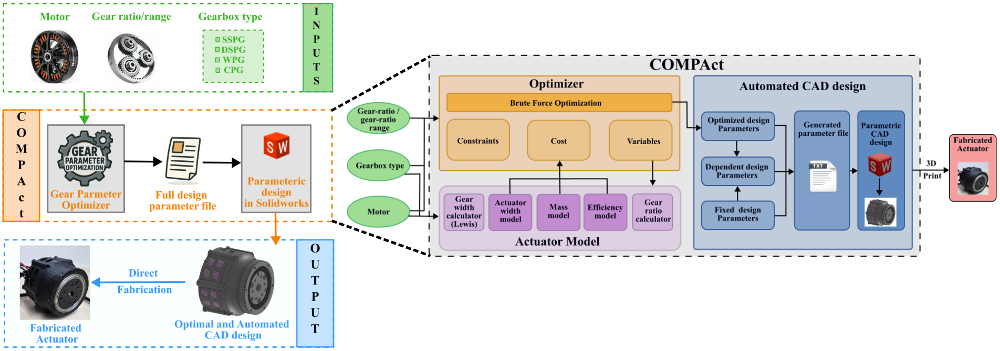

# COMPAct: Actuator design framework

This repository provides an implementation of the paper:

<td style="padding:20px;width:75%;vertical-align:middle">
      <a href="https://arxiv.org/abs/2510.07197" target="_blank">
      <b> COMPAct: Computational Optimization and Automated Modular design of Planetary Actuators </b>
      </a>
      <br>
      <a href="https://singhaman1750.github.io/" target="_blank">Aman Singh</a>, <a href="https://www.linkedin.com/in/deepak-kapa-iitr26/" target="_blank">Deepak Kapa</a>, <a href="https://www.linkedin.com/in/suryank-joshi/" target="_blank">Suryank Joshi</a>, and <a href="https://www.shishirny.com/" target="_blank">Shishir Kolathaya</a>
      <br>
      <em>IEEE International Conference on Robotics and Automation</em>, 2026
      <br>
      <a href="https://youtu.be/99zOKgxsDho?si=5hyMySFOMPunLLCl">Video-Overview</a>
    <br>
</td>

<br>

Given a motor and a gear ratio, COMPAct finds the planetary gearbox (teeth, module, number of planets,
face widths) that minimises actuator mass and width while maximising efficiency, and writes the
parameters that drive a parametric CAD model (SolidWorks or Onshape), ready to 3D-print.

<p align="center">
  
</p>

---

## Install

Requires **Python 3** (on Windows, [Git Bash](https://git-scm.com/downloads) is recommended).

```bash
git clone https://github.com/singhaman1750/COMPAct.git
cd COMPAct
pip install -r requirements.txt
```

## Quick start

```bash
python actOpt.py --motor U8_Lite --gb_type sspg --gr 6.5
```

| Option | Meaning |
|---|---|
| `--motor` | A motor from [`config_files/motors.json`](config_files/motors.json) (see [Motors](#motors)) |
| `--gb_type` | A gearbox type from the table below |
| `--gr` | Gear ratio (> 2). The optimiser returns the best design near this ratio. |
| `--material` | `3dp` (default): PLA gears and structure. `metal`: steel gears, aluminium structure (see [Material modes](#material-modes)) |
| `--onshape` | Also push the result into your Onshape model (see [CAD](#cad-models)) |

The terminal shows the chosen design (teeth, module, planets, ratio). Two files are written:
- `results/results_BruteForce_<motor>/<TYPE>_BRUTEFORCE_MIT_<motor>.csv` — mass, efficiency,
  width, cost and the mass of every part (`..._metal.csv` in metal mode);
- `CADs/<TYPE>/<type>_equations*.txt` — the parameters for the CAD model. Every run overwrites
  these; `git checkout -- CADs` restores the committed versions.

## Gearbox types

| `--gb_type` | Gearbox | Motor kind | Example | Onshape model |
|---|---|---|---|---|
| `sspg` | Single-stage planetary | framed outrunner | `--motor U8_Lite --gr 6.5` | [open](https://cad.onshape.com/documents/c1aac326515ba734f63b9b3f/w/f9cccd7b90ce6d7934076c7c/e/11d494d64974a13f1ae2def2) |
| `cpg` | Compound planetary | framed outrunner | `--motor U8_Lite --gr 10` | [open](https://cad.onshape.com/documents/dabf50453c93c1c427cef77a/w/58e59ba240adf6d2a07794cc/e/2fd7bc338e9316193d1a2f79) |
| `wpg` | Wolfrom planetary (3K) | framed outrunner | `--motor U8_Lite --gr 20` | [open](https://cad.onshape.com/documents/f63553f1c266228274914c8c/w/f5b45617c0141f8d43fbf21e/e/1c09941ddaf2e9f39000d746) |
| `dspg` | Double-stage planetary | framed outrunner | `--motor U8_Lite --gr 20` | [open](https://cad.onshape.com/documents/b8d43d150fb932ea649dcd0f/w/aaa3fcc8da584cc207374389/e/12e148469fa8eb5b917f5bb1) |
| `isspg_inside` | Internal single-stage, InBearing | frameless outrunner | `--motor RO100 --gr 6.5` | [open](https://cad.onshape.com/documents/9fa91e98fe82c4e544284d41/w/828f637e6a1fef0940224c5c/e/c80b77fbcf87c09b3b593c8a) |
| `isspg_compact` | Internal single-stage, OutBearing | frameless outrunner | `--motor RO100 --gr 6.5` | [open](https://cad.onshape.com/documents/bf5f13d9187efab731a95ba7/w/1261f6088846b1d6dd38ea32/e/9442fa2e352d23d6eb88bc6e) |
| `icpg` | Internal compound | frameless outrunner | `--motor RO100 --gr 10` | [open](https://cad.onshape.com/documents/1cec852caa1080765682d3d0/w/9b7913f319aab1fd6ef5de45/e/f9d06c56e5c97df7f6c68aa9) |
| `idspg` | Internal double-stage | frameless outrunner | `--motor RO100 --gr 20` | [open](https://cad.onshape.com/documents/bfc847aa97321639994fa267/w/e42f2a8d3124414ae728bb05/e/19b7631b19424696aeb05c64) |
| `insspg_type_1` | Inrunner single-stage, type 1, Independent | frameless inrunner | `--motor RI100 --gr 6.5` |  [open](https://cad.onshape.com/documents/e0cb8ed6bb2b36cfcadffcf4/w/a5de456488f59701ab182711/e/b8af8d5da69957495c24591f) |
| `insspg_type_2` | Inrunner single-stage, type 2, Dependent | frameless inrunner | `--motor RI100 --gr 6.5` | [open](https://cad.onshape.com/documents/97af418b118f30715235cd6a/w/253f8dd6e8e424cb9f7bb1dd/e/bcd4cd4dc6121c4e6915a50e) |
| `incpg_dependent` | Inrunner compound, dependent | frameless inrunner | `--motor RI100 --gr 10` | [open](https://cad.onshape.com/documents/3e794c46f172f3b02cfa18e7/w/dfc878270d998ca1ea8223c8/e/c324bd70f7c31566e927c1f7) |
| `incpg_independent` | Inrunner compound, independent | frameless inrunner | `--motor RI100 --gr 10` | [open](https://cad.onshape.com/documents/2519b08c3c51bbdac1923e25/w/095a9ef04c28fad58dcdbe6c/e/7335150ff09908ff2cd1b9b2) |
| `inwpg_dependent` | Inrunner Wolfrom, dependent | frameless inrunner | `--motor RI100 --gr 20` | [open](https://cad.onshape.com/documents/a5e4d1f2afed2d53000ac6c5/w/fa005d0cbd6ffa3820332b7d/e/64e86c89d3ac5b23fd7711ba) |
| `inwpg_independent` | Inrunner Wolfrom, independent | frameless inrunner | `--motor RI100 --gr 20` | [open](https://cad.onshape.com/documents/a5ebf8aa022054aedcbab90e/w/226eaf19e9c48cb8a6efbe49/e/e7a9e7fa0a60f50822757623) |
| `indspg` | Inrunner double-stage | frameless inrunner | `--motor RI100 --gr 20` | [open](https://cad.onshape.com/documents/082ad023b75b2274bed0f04d/w/29fd6b162304a5c614568daf/e/f5c1a1cba8355822de1c14c1) |

⚠️ ICPG, IDSPG, INSSPG and INDSPG models are still shared view-only and cannot be copied yet
([ISSUES.md, CAD 2](ISSUES.md)). This bug is fixed, remove this line
Each type is described in [docs/gearboxes.md](docs/gearboxes.md).

## Motors

[`config_files/motors.json`](config_files/motors.json) holds 33 motors with datasheet values and their
sources. A gearbox type accepts any motor of its kind:

| Motor kind | Motors |
|---|---|
| Framed outrunner | T-Motor U8 Lite / Lite L / II / II Lite / II PRO, U10 Plus KV80, U10 II, MN5008, MN6007 II, MN7005, MN8012, MN8014, MN8017, MN1005 V2; MAD M6C12, M6C10, M6C08, M6C06, M6C06 V3, 1005, 7005, 8118, 5008, 5010; Vector 8008 SL, 8015 SL, 10005 SL, 8020 PRO |
| Frameless outrunner | RO100, RO80, RO60 |
| Frameless inrunner | RI100, RI80 |

Gears are sized with each motor's **peak torque** and checked at its **no-load speed** (48 V supply);
set `"rating"` in `motors.json` to `"rated"` to use rated values instead (frameless motors only).
Use the exact names from `motors.json` (e.g. `MAD_M6C12_KV170`); a wrong name lists the valid ones.
To add a motor, see [docs/motors.md](docs/motors.md).

## Material modes

| `--material` | Gears (incl. ring gear) | Structure | Rotor coupler |
|---|---|---|---|
| `3dp` (default) | PLA | PLA | aluminium |
| `metal` | steel, 7850 kg/m³, 400 MPa | aluminium, 2700 kg/m³ | aluminium |

Metal mode still uses the 3D-printed part shapes and wall thicknesses, so metal designs come out
narrower but heavier than they would with metal-specific walls (follow-up in [ISSUES.md](ISSUES.md)).

## CAD models

**Onshape (cloud):** make your own copy of a model, list it once in
`Onshape_extension/onshape_models.json`, then add `--onshape` to any optimisation:
```bash
python actOpt.py --motor U8_Lite --gb_type sspg --gr 6.5 --onshape
```
Setup, re-pushing a saved result and troubleshooting: [docs/onshape.md](docs/onshape.md).

**SolidWorks (local, SolidWorks 2024 or newer):** SSPG, CPG, WPG and DSPG have models in
`CADs/<TYPE>/<type>_actuator.zip` (CPG is already unzipped). Unzip the archive into the same folder
so that you get `CADs/<TYPE>/<type>_actuator/<type>_actuator.SLDASM` (some unzip tools add an
extra folder level — remove it). Run an optimisation, open the `.SLDASM` and click **Rebuild**; the
model follows the new `CADs/<TYPE>/<type>_equations*.txt`.

**Build:** export the printed parts to STL; the CAD model shows which standard bearings to fit.
Example STL sets are in `CADs/Actuator_STL_files/`. A spreadsheet with a mass analysis is
[here](https://docs.google.com/spreadsheets/d/1QYUox6946nNlciWFAQ1L-EqQNLNdAT6GV0OtC5uI0eU/edit?usp=sharing).

## For developers

- [`gearbox_runner.py`](gearbox_runner.py) — one table (`GEARBOXES`) describing every gearbox type,
  and `run()`, which builds and optimises it. The gearbox maths is in `ActuatorAndGearbox*.py`.
- Tests: `python -m pytest`; the slow golden-output check is described in [tests/README.md](tests/README.md).
- Known bugs and open tasks: [ISSUES.md](ISSUES.md).

## Citation

If you use this framework in your research, please cite:

```bibtex
@misc{singh2025compact,
      title={COMPAct: Computational Optimization and Automated Modular design of Planetary Actuators}, 
      author={Aman Singh and Deepak Kapa and Suryank Joshi and Shishir Kolathaya},
      year={2025},
      eprint={2510.07197},
      archivePrefix={arXiv},
      primaryClass={cs.RO},
      url={https://arxiv.org/abs/2510.07197}, 
}
```

## What's new

- **More actuators:** besides the original four (SSPG, CPG, WPG, DSPG), COMPAct now designs 11
  actuator types for frameless outrunner and inrunner motors — 15 in total (see
  [Gearbox types](#gearbox-types)).
- **WPG corrected:** new WPG design and corrected part masses.
- 33 motors, metal mode (`--material metal`) and one-command Onshape updates (`--onshape`).
